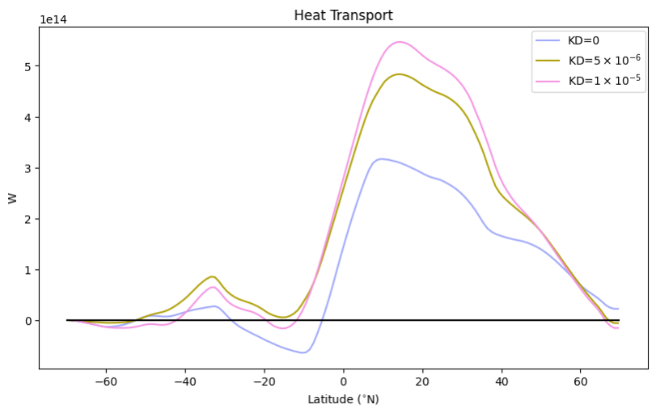

Previous Research
Impact of vertical diffusivity on large-scale circulation

 

At Texas A&M, I studied how changing a model's background diffusivity parameterization impacted heat transport in the Atlantic Meridional Overturning Circulation. To investigate this, I set up an idealized, single-channel experiment and tested a Lagrangian particle tracking package in MOM6. We found that the volume andtemperature of the AMOC return flow increased as vertical diffusivity increased.  
